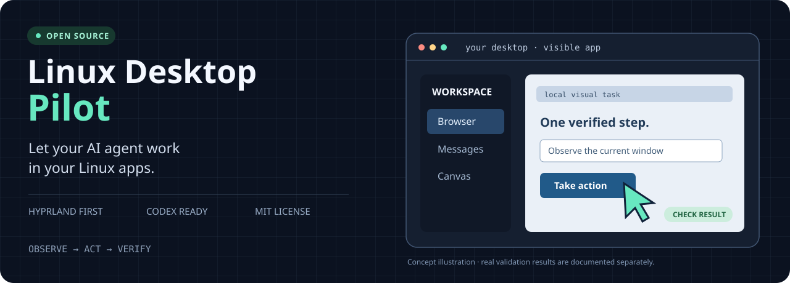

<p align="center">
  
</p>

<p align="center">
  <a href="https://github.com/gosthexect-arch/linux-desktop-pilot/actions/workflows/tests.yml"></a>
  <a href="LICENSE"></a>
  
  <a href="CONTRIBUTING.md"></a>
</p>

<p align="center"><b>Computer Use for Codex on Linux. Screenshots, mouse, keyboard, and a plan that adapts.</b></p>
<p align="center"><a href="#install-for-codex">Install</a> · <a href="#try-a-real-task">Examples</a> · <a href="#what-is-verified">Compatibility</a> · <a href="CONTRIBUTING.md">Contribute</a> · <a href="README.pt-BR.md">Português brasileiro</a></p>

## Give your agent a desktop workflow

Linux Desktop Pilot is an open-source **Agent Skill** that guides an AI agent
through visible Linux applications. It combines screenshots and accessibility
with mouse and keyboard control, checks the result, and changes navigation when
the first route fails.

**Hyprland is the primary target.** GNOME and KDE Plasma adapters are included
through an optional Linux backend and are awaiting real desktop validation.

| What you want to do | How the skill approaches it |
| --- | --- |
| Work in a browser | Use the visible browser, tabs, links, fields and dialogs |
| Prepare communication | Verify the conversation and compose a reviewable draft |
| Work in a creative tool | Navigate the active canvas, viewport, menus and properties |
| Recover from a failed action | Reobserve focus, layout and application mode, then choose another route |

For an interface-only task, the agent works through the UI. Browser DOM scripts,
application APIs and Blender Python scripts are outside that operating mode.

## Install for Codex

### One command with the skills CLI

Requires Node.js **22.20+** for the third-party skills CLI:

```bash
npx skills add gosthexect-arch/linux-desktop-pilot --skill linux-visual-computer-use -a codex -g
```

This installs the skill instructions and helpers. System GUI dependencies still
need to be available. Start a new Codex conversation, then try:

```text
Use $linux-visual-computer-use to operate my browser visually.
Start by checking the desktop, then ask me which page to work on.
```

### Python-only installation

Requires Git and Python **3.9+**. No pip packages are needed for the helpers.

```bash
git clone https://github.com/gosthexect-arch/linux-desktop-pilot.git
cd linux-desktop-pilot
python3 linux-visual-computer-use/scripts/install.py
```

The installer uses your `CODEX_HOME/skills` or defaults to `~/.codex/skills`.
It prints the exact diagnostic command, preserves a backup when updating, and
does not change compositor settings. Choose one installation method per agent
to avoid duplicate copies of the same skill.

Run the read-only diagnostic from the clone:

```bash
python3 linux-visual-computer-use/scripts/desktop.py doctor
```

To install the optional native Linux MCP runtime as well:

```bash
python3 linux-visual-computer-use/scripts/install.py --with-native
```

That option needs npm/Node.js 18+ and downloads the pinned upstream runtime.
See [installation and model compatibility](linux-visual-computer-use/references/portability.md)
and [desktop adapters](linux-visual-computer-use/references/backends.md).

<details>
<summary><b>Using Claude Code or another Agent Skills client?</b></summary>

The skill uses the open `SKILL.md` format. The skills CLI also supports:

```bash
npx skills add gosthexect-arch/linux-desktop-pilot --skill linux-visual-computer-use -a claude-code -g
```

This is an installation path, not a Claude acceptance result. Your client/model
must receive screenshots and execute local GUI tools. Claude Code and other
hosts have not been tested end to end by this project yet.

</details>

## Try a real task

Copy a prompt and adapt it to the application you have open:

**Browser**

```text
Use $linux-visual-computer-use to navigate the open browser visually.
Fill the form I identify, check every field, and stop before submitting.
```

**WhatsApp or a communication app**

```text
Use $linux-visual-computer-use to prepare a draft in the conversation I select.
Confirm the recipient and the visible text. Stop before sending.
```

**An existing Blender project**

```text
Use $linux-visual-computer-use in my open Blender project.
Work through the interface, preserve the existing scene, and save a separate copy.
```

Communication and Blender prompts show intended workflows; live acceptance
tests for these applications are still pending. Explicitly authorized sends
remain possible; the skill does not ask again when recipient and intent are clear.

## What is verified?

| Area | Current evidence |
| --- | --- |
| Hyprland / Wayland | Real Chromium GUI run on Omarchy / Hyprland 0.56.2 |
| Browser primitives | Click, accented text, keyboard navigation, local form save and section links |
| Pointer gestures | Middle-button + Shift drag and scrolling on both axes |
| State checks | Input refused after focus changes; stale geometry checks covered by tests |
| Installation and helpers | 35 automated regression tests, including a relocated ZIP install |
| GNOME / KDE Plasma | Adapters available; real session validation pending |
| WhatsApp / Blender / other models | Real application or model acceptance pending |

Read the [validation record](docs/validation.md). A passing diagnostic detects
a candidate control path; it does not prove the model completed a GUI task.

## Requirements and boundaries

- An active Linux graphical session and a host that loads skills, shows actual
  screenshot images to the model, and executes GUI tools.
- For the direct Hyprland path: `hyprctl`, `grim`, `wtype`, Wayland client
  libraries and advertised virtual pointer support. Modifier gestures also use
  virtual keyboard support and `libxkbcommon`.
- For GNOME/KDE: the optional backend plus a working compositor/portal/input
  configuration. Diagnose the actual session before using it.

The skill does not pin a model ID or call a model API itself. Models and clients
still differ in vision, tool access and task performance. There is no claim of
universal model, application or distribution compatibility.

## Make Linux desktop automation better

**Your tested setup is a useful contribution.** Report a reproducible task,
improve a recovery path, fix a helper, translate docs, or submit a GNOME/KDE
validation report. [Open an issue](https://github.com/gosthexect-arch/linux-desktop-pilot/issues/new/choose)
or read [CONTRIBUTING.md](CONTRIBUTING.md) to submit a pull request.

```bash
python3 -m unittest discover -s tests -v
python3 tools/build_release.py
```

Tests run without controlling your desktop. Real GUI acceptance is documented
separately. Contributions should keep those evidence types distinct.

## Free and open source

This project's code and instructions are free under the [MIT license](LICENSE),
including personal and commercial use. Your chosen model provider's subscription
or API fees are separate. See [third-party notices](THIRD_PARTY_NOTICES.md) for
the optional runtimes and protocols we build on.

Independent community project. Not affiliated with OpenAI, Anthropic, Hyprland,
Blender or WhatsApp.
