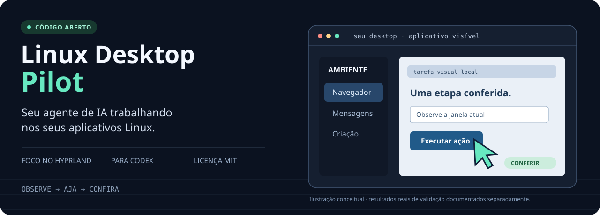

<p align="center">
  
</p>

<p align="center">
  <a href="https://github.com/gosthexect-arch/linux-desktop-pilot/actions/workflows/tests.yml"></a>
  <a href="LICENSE"></a>
  
  <a href="CONTRIBUTING.md"></a>
</p>

<p align="center"><b>Computer Use para Codex no Linux. Capturas de tela, mouse, teclado e um plano que se adapta.</b></p>
<p align="center"><a href="#instalar-no-codex">Instalação</a> · <a href="#experimente-uma-tarefa-real">Exemplos</a> · <a href="#o-que-já-foi-validado">Compatibilidade</a> · <a href="CONTRIBUTING.md">Contribuir</a> · <a href="README.md">English</a></p>

## Dê ao seu agente um fluxo de trabalho no desktop

Linux Desktop Pilot é uma **Agent Skill** de código aberto: um conjunto de
instruções e ferramentas auxiliares que orienta um agente de IA em aplicativos
visíveis no Linux. Ela combina capturas de tela e recursos de acessibilidade com
controle de mouse e teclado, confere o resultado e muda a navegação quando o
primeiro caminho falha.

**O foco principal é Hyprland.** As integrações para GNOME e KDE Plasma estão
disponíveis por meio de um runtime Linux opcional e ainda precisam de validação
em sessões reais desses ambientes.

| O que você quer fazer | Como a skill aborda a tarefa |
| --- | --- |
| Trabalhar em um navegador | Usar o navegador visível, suas abas, links, campos e caixas de diálogo |
| Preparar uma mensagem | Conferir a conversa e preparar um rascunho para revisão |
| Trabalhar em uma ferramenta de criação | Navegar pela área de trabalho do aplicativo, visualização, menus e propriedades |
| Recuperar uma ação que falhou | Observar novamente o foco, a disposição da interface e o modo do aplicativo, depois escolher outro caminho |

Quando a tarefa exige uso exclusivo da interface, o agente trabalha pela
interface. Scripts de DOM do navegador, APIs de aplicativos e scripts Python
do Blender ficam fora desse modo de operação.

## Instalar no Codex

### Um comando com a CLI skills

A CLI skills, mantida por terceiros, exige Node.js **22.20 ou superior**:

```bash
npx skills add gosthexect-arch/linux-desktop-pilot --skill linux-visual-computer-use -a codex -g
```

Isso instala as instruções e os auxiliares da skill. As dependências gráficas
do sistema também precisam estar disponíveis. Abra uma nova conversa no Codex
e experimente:

```text
Use $linux-visual-computer-use para operar meu navegador pela interface.
Comece verificando o ambiente gráfico e depois me pergunte em qual página trabalhar.
```

### Instalação apenas com Python

Exige Git e Python **3.9 ou superior**. Os auxiliares não precisam de pacotes pip.

```bash
git clone https://github.com/gosthexect-arch/linux-desktop-pilot.git
cd linux-desktop-pilot
python3 linux-visual-computer-use/scripts/install.py
```

O instalador usa a pasta `skills` dentro de `CODEX_HOME` ou, por padrão,
`~/.codex/skills`. Ele informa o comando exato de diagnóstico, preserva uma
cópia de segurança nas atualizações e não altera as configurações do compositor.
Escolha um método de instalação por agente para evitar cópias duplicadas da
mesma skill.

Execute o diagnóstico, que apenas consulta o ambiente, a partir da pasta clonada:

```bash
python3 linux-visual-computer-use/scripts/desktop.py doctor
```

Para instalar também o runtime MCP Linux opcional:

```bash
python3 linux-visual-computer-use/scripts/install.py --with-native
```

Essa opção exige npm/Node.js 18 ou superior e baixa a versão fixada do runtime
de terceiros. Veja os guias de [instalação e compatibilidade de modelos](linux-visual-computer-use/references/portability.md)
e de [integrações com ambientes gráficos](linux-visual-computer-use/references/backends.md).

<details>
<summary><b>Usa Claude Code ou outro cliente compatível com Agent Skills?</b></summary>

A skill usa o formato aberto `SKILL.md`. A CLI skills também oferece:

```bash
npx skills add gosthexect-arch/linux-desktop-pilot --skill linux-visual-computer-use -a claude-code -g
```

Esse é um caminho de instalação; ele não comprova o funcionamento no Claude.
Seu cliente e modelo precisam receber capturas de tela e executar ferramentas
locais de interface gráfica. O projeto ainda não realizou testes completos
de ponta a ponta com Claude Code ou outros clientes.

</details>

## Experimente uma tarefa real

Copie um exemplo e adapte ao aplicativo que você tem aberto:

**Navegador**

```text
Use $linux-visual-computer-use para navegar visualmente no navegador aberto.
Preencha o formulário que eu indicar, confira todos os campos e pare antes de enviar.
```

**WhatsApp ou outro aplicativo de comunicação**

```text
Use $linux-visual-computer-use para preparar um rascunho na conversa que eu selecionar.
Confira o destinatário e o texto visível. Pare antes de enviar.
```

**Um projeto existente no Blender**

```text
Use $linux-visual-computer-use no meu projeto Blender aberto.
Trabalhe pela interface, preserve a cena existente e salve uma cópia separada.
```

Os exemplos de comunicação e Blender mostram os fluxos pretendidos; os testes
reais de aceitação nesses aplicativos ainda estão pendentes. Envios autorizados
explicitamente continuam possíveis: a skill não pede confirmação novamente
quando o destinatário e a intenção já estão claros.

## O que já foi validado?

| Área | Evidência atual |
| --- | --- |
| Hyprland / Wayland | Teste real de interface no Chromium, em Omarchy / Hyprland 0.56.2 |
| Ações básicas no navegador | Clique, texto com acentos, navegação por teclado, salvamento de formulário local e links de seção |
| Gestos do ponteiro | Arraste com botão central + Shift e rolagem nos dois eixos |
| Verificações de estado | Entrada recusada após mudança de foco; testes cobrem a detecção de geometria desatualizada |
| Instalação e auxiliares | 35 testes automatizados de regressão, incluindo instalação de um ZIP extraído em outro local |
| GNOME / KDE Plasma | Integrações disponíveis; validação em sessões reais pendente |
| WhatsApp / Blender / outros modelos | Testes de aceitação em aplicativos reais ou com outros modelos pendentes |

Leia o [registro de validação](docs/validation.md). Um diagnóstico bem-sucedido
detecta um caminho de controle candidato; ele não comprova que o modelo
concluiu uma tarefa pela interface gráfica.

## Requisitos e limites

- Uma sessão gráfica Linux ativa e um cliente que carregue skills, mostre
  imagens reais das capturas de tela ao modelo e execute ferramentas de
  interface gráfica.
- Para o controle direto no Hyprland: `hyprctl`, `grim`, `wtype`, bibliotecas
  cliente do Wayland e suporte a ponteiro virtual anunciado pelo compositor.
  Gestos com teclas modificadoras também usam suporte a teclado virtual
  e `libxkbcommon`.
- Para GNOME/KDE: o backend opcional e uma configuração funcional de compositor,
  portal e entrada. Faça o diagnóstico da sessão real antes de usar.

A skill não fixa um identificador de modelo nem chama uma API de modelos por
conta própria. Modelos e clientes diferem em visão, acesso a ferramentas e
desempenho nas tarefas. O projeto não afirma compatibilidade universal com
modelos, aplicativos ou distribuições.

## Ajude a melhorar a automação do desktop Linux

**O ambiente que você testou é uma contribuição útil.** Relate uma tarefa
reproduzível, melhore um caminho de recuperação, corrija um auxiliar, traduza
a documentação ou envie um relatório de validação no GNOME/KDE.
[Abra uma issue](https://github.com/gosthexect-arch/linux-desktop-pilot/issues/new/choose)
ou leia o [guia de contribuição](CONTRIBUTING.md) para enviar um pull request.

```bash
python3 -m unittest discover -s tests -v
python3 tools/build_release.py
```

Os testes rodam sem controlar seu desktop. Os testes reais de aceitação pela
interface são documentados separadamente. As contribuições devem manter essa
distinção entre os tipos de evidência.

## Gratuito e de código aberto

O código e as instruções do projeto são gratuitos e estão sob a
[licença MIT](LICENSE), incluindo uso pessoal e comercial. Assinaturas ou
custos de API do provedor de modelos que você escolher são separados.
Veja os [avisos sobre componentes de terceiros](THIRD_PARTY_NOTICES.md) para
conhecer os runtimes opcionais e protocolos usados pelo projeto.

Projeto independente, sem afiliação com OpenAI, Anthropic, Hyprland,
Blender ou WhatsApp.
